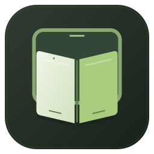
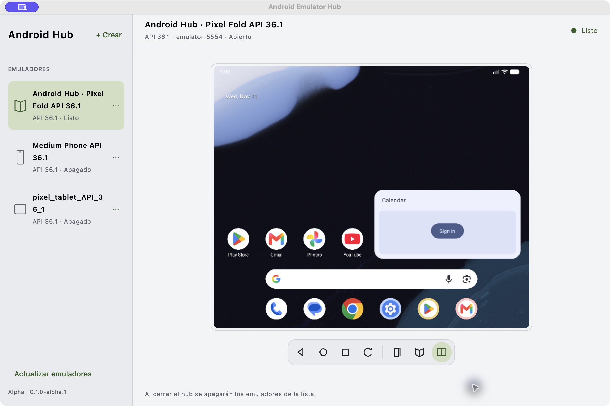
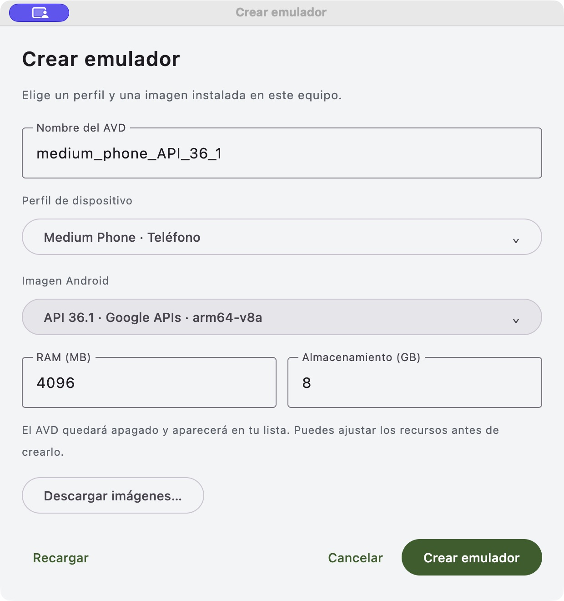
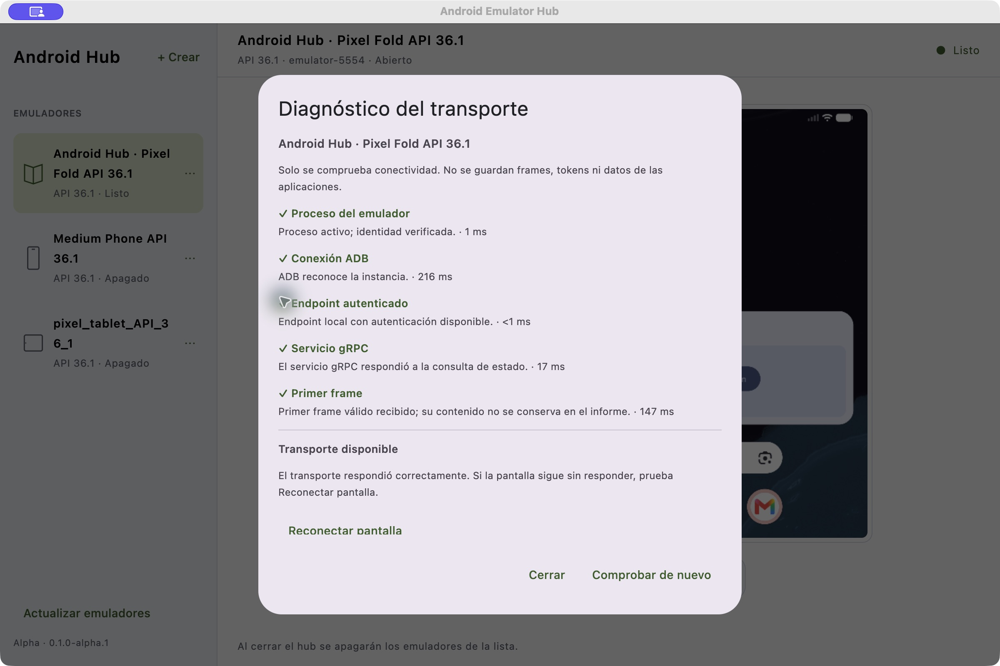

# Android Emulator Hub for macOS

Codename: **Kasane (重ね)**. The product name is provisional; the repository and bundle identifier remain `kasane` / `dev.picon.kasane`.

[](https://github.com/DevPicon/kasane/actions/workflows/build.yml)
[](https://github.com/DevPicon/kasane/actions/workflows/tests.yml)
[](https://github.com/DevPicon/kasane/releases)




**Create, manage and control Android emulators from one macOS window.**

Android Emulator Hub brings your Android virtual devices into a shared workspace. Its codename Kasane (重ね, “layering”) reflects that shared surface. Keep two emulators running, switch the displayed device, and interact with its live screen without opening separate emulator windows or Android Studio. Test a handset, a tablet or a foldable using the controls its hardware actually supports.

Created by **Armando Picón — [@devpicon](https://github.com/DevPicon)**. Find him as **@devpicon on all social networks**.

## Capture emulator screens

Use the camera and video icons in the top toolbar. Hover over an icon to see its action name, or focus it with the keyboard. A screenshot prompts for a destination. Recording starts immediately in a private temporary file; the red stop square finishes the MP4 and then opens the save dialog. Canceling that dialog keeps the video pending, with Save and Discard actions. Discard asks for confirmation. An existing destination file is preserved, and a failed export keeps the temporary recording available to retry.

**Show taps** controls Android's touch indicators during the video and restores the previous setting before the save dialog. One video can run at a time, pinned to its original emulator even when you select another device. The three-minute limit, individual shutdown/restart and Hub close all finalize recording. Closing remains blocked until a pending video is saved or explicitly discarded. Videos have no audio; rotation and fold posture controls are disabled for the recorded device. Displays without screenrecord support report an error; Android-protected content may appear blank. Captures stay local and do not include the Mac desktop.

Known preview limitation: on the tested Android image, a completely static recording can contain a single frame with zero reported duration. Record interactions when evaluating video capture; preserving elapsed time for idle recordings remains pending.

## Language

English is the initial language, regardless of macOS settings. Choose **English**, **Español** or **Português** in the top-right language selector; the preference is saved locally and changes the interface immediately. AVD names, SDK labels, paths, versions and raw tool output are preserved. Native macOS dialog buttons follow the system language.

## Screenshots

Real captures from **0.1.0-alpha.1** on macOS with a local Pixel Fold AVD. These older screenshots show the Spanish interface. These are application captures, not mockups; the emulator launcher contains no signed-in account.



| Create an AVD | Diagnose the transport |
| --- | --- |
|  |  |

## What you can do

- Browse configured AVDs, including powered-off devices, with icons for their form factor.
- Start, shut down or restart individual devices while other sessions keep running. Restart preserves the AVD and its data.
- Interact through live video, pointer gestures and keyboard input using a direct Android Emulator gRPC client.
- Diagnose process identity, ADB, authenticated endpoint, gRPC and the first frame without interrupting the screen. Reconnect explicitly when needed.
- Use Back, Home, Recents and rotation. Foldables expose their supported postures, with a gentle fade when the screen changes.
- Create AVDs from CLI-supported hardware profiles and installed images, with editable RAM and storage.
- Download stable Android system images for the Mac's architecture, with progress, cancellation and retry.
- Delete a powered-off AVD from its context menu or **⋯** menu after confirming permanent data loss. Shared SDK images are preserved.
- Close the Hub to shut down the emulators in its inventory, including instances started outside the app. Failed shutdowns keep the window open for retry.

**Preview:** macOS only. Apple Silicon is the locally validated runtime; Intel packages are built separately in CI. Windows and Linux are planned. The Hub shows one device screen at a time; physical devices and audio are outside this version. It does not depend on scrcpy.

## Install the current macOS alpha

Latest published alpha: **0.1.0-alpha.2**. This is an early `0.x` preview with no stable compatibility promise. The historical `v1.0.0` tag was numbered incorrectly and is retained only as a legacy preview. Use the newest alpha in Releases.

1. Open [Releases](https://github.com/DevPicon/kasane/releases) and choose the newest alpha.
2. Download the DMG for your Mac: `kasane-<version>-macos-arm64.dmg` for Apple Silicon or `kasane-<version>-macos-x64.dmg` for Intel. ZIP alternatives are also available. **About This Mac** identifies your chip.
3. Optionally verify the archive with its matching `.sha256` file:
   ```sh
   shasum -a 256 -c kasane-<version>-macos-arm64.dmg.sha256
   ```
4. Open the DMG, drag **Android Emulator Hub.app** to **Applications**, eject the volume, and open the installed app. For ZIP downloads, extract the archive and move the app to Applications.

The full version and authorship appear under **Help → Acerca de…** or the native macOS About menu.

Packages include their Java runtime. The preview is **not Developer ID signed or notarized**. macOS may block it; after verifying the source, use the explicit approval in **System Settings → Privacy & Security** as described by [Apple](https://support.apple.com/en-us/102445). Do not disable Gatekeeper globally.

The optional local [Developer ID signing and notarization flow](docs/macos-signing.md) produces a distinct `*-notarized.dmg` only after Apple and Gatekeeper checks succeed. Standard CI artifacts remain ad-hoc builds.

While the repository remains private, releases, Actions and artifacts require repository access; badges may not render for unauthenticated readers. Build and test badges report workflow results, not hand-written “passing” labels.

## Android SDK requirements

Kasane uses your existing Android SDK; it does not bundle the SDK or system images. Install:

- Android Emulator and Platform Tools (`adb`).
- Android SDK Command-line Tools **latest** (`avdmanager` and `sdkmanager`).
- A working JDK 17 or newer for the SDK command-line tools. The app's bundled runtime does not replace that SDK prerequisite.

The default SDK location is `~/Library/Android/sdk`. `ANDROID_SDK_ROOT` or `ANDROID_HOME` can select another location. `ANDROID_AVD_HOME` and `ANDROID_USER_HOME` are also respected. Environment variables must be available to the launched app; a Finder launch does not automatically inherit your shell configuration.

Locally validated with macOS 26.5.2 on Apple Silicon, Android Emulator **36.4.9**, API **36.1** Google APIs / Google Play images, Pixel Fold, Medium Phone and Pixel Tablet. The macOS CI packages use macOS 15 runners; building a package is separate from validating a real emulator on that architecture.

## First run

Choose an AVD and press **Iniciar emulador**. Its **⋯** / right-click menu offers **Apagar**, **Reiniciar** and **Diagnóstico…** when available. To create one, choose **+ Crear**, select a hardware profile and installed image, review resources, and confirm. Creation leaves the device powered off.

If you need an image, choose **Descargar imágenes…**, select a compatible package, and press **Descargar imagen**. The SDK tool does not publish download sizes in its textual catalog; Kasane checks a minimum of 6 GB free before installation, which is not a guarantee for every package. Completed downloads become available in the creation form without losing your edited name or resources.

Android Emulator Hub never accepts SDK licenses automatically. If an installation requires a license, review it yourself using your SDK's official tool, then retry:

```sh
"$HOME/Library/Android/sdk/cmdline-tools/latest/bin/sdkmanager" --licenses
```

Deleting an AVD removes its apps, user data and snapshots permanently. Running devices must be shut down first. Cancelling a download stops Kasane's installer process; SDK-managed partial downloads are left to the SDK rather than deleting shared files.

## Build from source

This lets you inspect the code, modify behavior, debug a problem or build a local package. The full steps and prerequisites are in [Build from source](docs/build-from-source.md).

```sh
git clone https://github.com/DevPicon/kasane.git
cd kasane
./gradlew test createDistributable --console=plain
```

Use JDK 17. The packaged app is written to `build/compose/binaries/main/app/Android Emulator Hub.app`. For development, `./gradlew run` starts the application. Tests use temporary SDK fixtures and do not modify real AVDs or accept licenses.

The code uses Kotlin/JVM, Compose Multiplatform Desktop, coroutines and a pinned Android Emulator protocol. See [architecture](docs/architecture.md), [contributing](CONTRIBUTING.md), [release process](docs/releases.md) and [third-party notices](THIRD_PARTY_NOTICES.md).

## Releases and collaboration

Every main-branch build publishes temporary macOS artifacts and test reports in [Actions](https://github.com/DevPicon/kasane/actions). Version tags such as `v0.1.0-alpha.1` run tests and build both macOS packages before publishing release ZIPs and SHA-256 checksums. Versions use [SemVer](https://semver.org/); prereleases are marked as prereleases in GitHub. Use Releases for durable downloads; Actions artifacts expire.

The repository is currently private and **no project license has been granted**. Copyright © 2026 Armando Picón (@devpicon). Third-party components retain their own licenses. Please coordinate contributions with the author before submitting code; public collaboration and licensing terms are still being prepared.

Useful next steps: Developer ID signing/notarization, broader real-Mac compatibility testing and transport performance measurements. See the [signing and secrets guide](docs/macos-signing.md). Windows and Linux remain future work.
